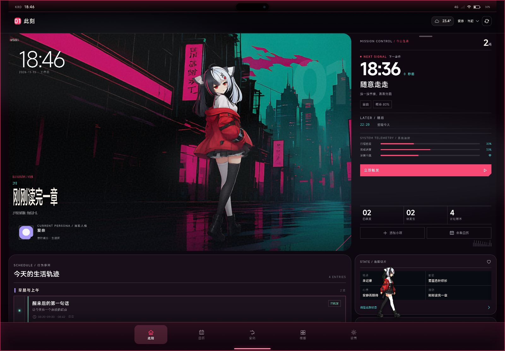

# 生活节律·日程插件（KRD）

**KiraRhythmDate** 让 KiraAI 中的每个人格拥有独立的生活线：规划、感知当下、触发小项、保留梦与体验，并主动修改后续安排。它不是提醒命令合集，也不要求 bot 为每个小项额外报告一次“完成”。

- 插件 ID：`kira_rhythm_Date`
- 内部名：`KiraRhythmDate`
- 简称：`KRD`
- 核心版本：`KiraAI >=3.1.2`
- 许可证：AGPL-3.0



## 功能总览

### 自主生活闭环

- 每日定时规划，默认 23:00；**已有计划也触发**，作为一次修订机会。
- 当前全部小项终态后，再给予一次规划机会。
- `rhythm_plan` 创建/修订单日或多日计划；多日使用原子事务。
- `rhythm_update` 调整小项、DayState，或保存梦与体验。
- `rhythm_view` 按需读取历史、当前组、diff、配额与体验。
- 正常模型响应即 `triggered`；`<msg/>` 是合法的 `triggered_silent`，不是失败。
- `must_message` 单独记录 `delivery_unmet`，不把投递要求与模型成功混淆。

### 精确、时间窗与概率

- 精确到分钟；支持 IANA 时区、跨午夜与 DST 检查。
- 时间窗内随机一次，或按最小/最大间隔生成多次独立小项。
- 随机落点、概率抽签与执行认领先于外部副作用写入 SQLite；重载不重抽。
- 默认每日 **2–12 项**，bot 不必塞满。
- 禁止执行、安静投递、必需覆盖时段分别配置。

### 人格与日型

- Plan、DayState、Experience、日型、会话池、天气、图片与运行记录按 `persona_id` 隔离。
- 切换人格会暂停旧生活线并恢复新人格自己的有效安排，不共享“我的昨天”。
- 工作日、周末、假日、调休工作日为内置日型；可创建大量自定义日型。
- 每个日型可覆盖规划提示词、数量、会话策略与日期规则。

### 每日总体状态

Plan 保存预计服装、心情与总体思路；DayState 保存当前服装、心情、地点、活动和思路。当前值优先，明确修改才改变，不让早晨设定绑架整天上下文。

### 梦境与安静活动

```text
凌晨 silent 做梦 → 私有 Experience → 早晨 auto/must_message 梦后分享
```

安静活动不要求发言；只有需要后续引用的体验才写记录。

### 天气与头像

无账号优先：

| Provider | 范围/说明 |
|---|---|
| Open-Meteo | 全球，非商业免费有额度并需署名 |
| MET Norway | 全球预报，需真实 User-Agent、缓存和署名 |
| US NWS | 美国境内，需 User-Agent |
| Bright Sky / DWD | 德国观测突出，预报覆盖较广 |

免费注册/免费套餐：WeatherAPI、Visual Crossing、和风天气、Weatherbit、OpenWeather。套餐与额度以服务商当前页面为准；OpenWeather 的部分产品可能需要信用卡或订阅验证。

支持真实、虚拟和混合模式；虚拟气候可复现并明确标记来源。天气失败使用新鲜缓存或带时间的旧缓存，不阻塞调度。

生活头像默认按稳定顺序自动获取在线适配器头像，之后回退人格参考图和内置图。普通读取使用 24 小时缓存；**每次重新进入前端都会后台强制刷新远程头像**，不阻塞首屏，失败继续使用最后可用图片。也可上传头像与生活横幅；图片在本机校验、重编码并去 EXIF。

### 可视化面板

- 此刻：当前状态、天气、下一项、今日时间轴。
- 日历：月视图、日期详情与日型颜色。
- 变化：字段级 diff、修改原因、运行回执。
- 模板：内置计划、自定义计划模板、日型、15 套独立角色主题（5 名角色 × 3 套）、头像与横幅。
- 设置：规划、数量、三类时段、会话权限、天气、数据与诊断。
- 手机式界面：状态栏、锁屏时钟、底部应用 Dock、桌面与手机全屏自适应、15 套独立角色主题。
- 像素生活伙伴：识别日程关键词、天气、时间与事件，拥有连续跳跃、阅读、撑伞、围巾、赶路、打盹、被拿起、丢起、落地等动作，可拖拽互动。
- 减少动态、WebSocket 增量刷新。
- 所有业务配置保存即热生效，revision 冲突不会静默覆盖。

## 安装

将本仓库完整目录放到 KiraAI 的 `data/plugins/`：

```text
KiraAI/
└── data/
    └── plugins/
        └── kira_rhythm_Date/
            ├── main.py
            ├── manifest.json
            ├── schema.json
            ├── krd/
            ├── web/
            └── assets/
```

在插件管理中加载/重载 KRD，打开主 WebUI 左侧「生活节律」。首次使用建议：

1. 选择当前人格与允许会话；
2. 检查每日数量、规划时间与三类时段；
3. 按需配置天气地点或虚拟气候；
4. 点击「给予规划机会」，让 bot 创建或修订计划。

`startup_plan` 默认关闭，避免安装/凌晨启动时补跑昨日规划。需要自动启动补建时可显式开启。

## 历史与缓存

| 模式 | 行为 |
|---|---|
| `notice`（默认） | `[生活节律｜系统触发]` 短标记正常入历史；动态指令与状态全部 `persist=False` |
| `full` | 额外持久化用户明确选择的规划/执行模板，动态状态仍不持久 |
| `none` | 短标记也非持久；当前 3.1.2/3.2 的纯日程批次会留下空 user 记录，页面明确提示 |

这与主动唤醒 v2.5.0 和 QQ增强 v1.4.6 的边界一致：系统来源标记正常保存，附加动态上下文使用尾部非持久 Prompt。静态工具说明进入 `tools` system 区。

## 权限与安全

- 页面、API、WebSocket 均使用框架鉴权，不提供 `auth=False`。
- 会话采用白/黑名单、独立规划/执行池，执行时复核适配器权限。
- 默认空黑名单表示全允许；白名单为空表示没有可用会话。
- 天气密钥使用框架敏感字段，不进入自定义 API、WS、导出或日志。
- 上传图片限制 5 MiB、最大边 4096，服务端验证真实格式并重编码；不开放用户 SVG。
- 日程工具不能提高自身权限、修改概率下限或清除审计。

## 开发与验证

详细命令与结果见 [`docs/VERIFICATION.md`](docs/VERIFICATION.md)。核心测试覆盖：

- 双版本各 91 项领域/并发/调度/缓存/导入导出/天气/资源测试；
- 精确时间、时间窗、禁止/安静/必需覆盖时段和随机间隔支持秒级；LLM 工具与 WebUI 同步支持 `HH:MM[:SS]`。
- 真实 PluginManager 加载、3 工具、36 条鉴权 API/页面/静态路由、WS 与热更新；
- 真实 HTTP API 与真实 Chromium → 生产前端 → API → SQLite 闭环；
- 真实 IM 小项和规划工作流 Build → Assemble → Execute → Finalize；
- 百项压力、31 秒空闲无写入长稳、桌面与手机全视图巡检；
- S/Z 真实合批后 Message 引用和 `extra` 保留；
- 长期记忆 Z、群日报、加速器的兼容边界。

```sh
# 在 KiraAI 框架根目录运行；插件路径按实际位置替换
PYTHONPATH=/path/to/KiraAI:/path/to/kira_rhythm_Date \
  python3 -m pytest -q /path/to/kira_rhythm_Date/tests/
```

## 已知边界

- 进程在平台已发送而本地未落账的极窄窗口崩溃时，插件无法证明外部恰好一次；不确定运行标 `interrupted`，不盲目重发。
- 加速器流式抢发可能早于最终 XML 改写。KRD 用私有 Experience + 最终 `<msg/>` 和响应层抑制来避免静默泄漏；若要求对任意模型输出绝对强制静默，需要加速器提供请求级 suppress 能力。
- 天气套餐、接口覆盖和服务条款可能变化，Provider 元数据与 UI 应以官方当前页面为准。
- 导入备份在单事务中重映射对象 ID；不导入/重放 Run，历史计划归档，未决历史小项取消，已有同日计划跳过。

## 文档

- [完整设计与对齐稿](docs/DESIGN.zh-CN.md)
- [验证记录](docs/VERIFICATION.md)
- [更新日志](CHANGELOG.md)
